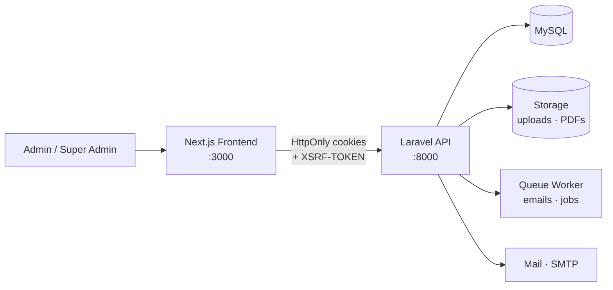
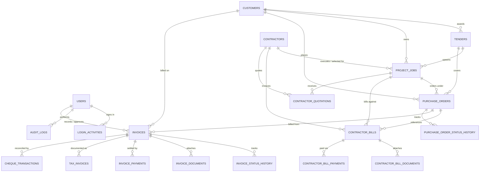

# Finance App Backend — Secure API

<div align="center">


<p align="center">
  <strong>ProcureX API — the secure engine behind the finance & procurement dashboard.</strong>
</p>

<p>
  <a href="#-api-overview">API</a> •
  <a href="#-database-schema">Schema</a> •
  <a href="#-roles--permissions">RBAC</a> •
  <a href="#-installation">Install</a> •
  <a href="#-testing">Testing</a> •
  <a href="../finance-frontend/README.md">Frontend</a>
</p>

</div>

---

## 📝 About The Project

**Finance App Backend** is a hardened Laravel API powering the ProcureX procurement console: authentication, master data, tenders & jobs, purchase orders, contractor billing, invoicing and PDF generation, RBAC, and audit — exposed as a versioned JSON API consumed by the [Next.js frontend](../finance-frontend/README.md) over cookie-based Sanctum sessions.

## ✨ What's Inside

| Domain | Highlights |
| :--- | :--- |
| 🔐 **Auth & security** | Sanctum SPA auth (HttpOnly cookies + CSRF), OTP password reset, two-factor login challenge, login history, active-session listing & revocation, configurable rate limits, account deactivation & permanent deletion |
| 👤 **Profile** | Avatar upload, profile & password update, secure email change with confirmation |
| 🏗️ **Procurement** | Customers, contractors, tenders, jobs, purchase orders — full CRUD with status history and audit trails |
| 👷 **Contractor billing** | Bill submission → verification → submission → approval/rejection → disbursement, document uploads, quotations & contractor selection, partial payments & retention |
| 🧾 **Invoicing & finance** | Invoice lifecycle, payment records, milestone/retention tracking, cheque transaction registry, executive summary analytics |
| 📄 **Documents & PDF** | Invoice PDF, internal receipt, PO PDF, job award letter, tender award letters (domPDF) |
| 🛡️ **Administration** | User directory, role & permission designer, audit logs, system metrics & logs, maintenance mode (Super Admin) |
| 🔔 **Notifications** | In-app notification feed with unread count and read-state management |
| 🎫 **Support tickets** | Help Center self-service tickets with `TKT-YYYY-####` numbering, per-user visibility and status tracking |

## 🧱 Tech Stack

| Concern | Technology |
| :--- | :--- |
| Framework | [Laravel 12](https://laravel.com) (PHP 8.2+) |
| Auth | [Laravel Sanctum 4](https://laravel.com/docs/sanctum) — SPA cookie mode |
| Authorization | [spatie/laravel-permission 6](https://spatie.be/docs/laravel-permission) — roles + granular permissions |
| PDF | [barryvdh/laravel-dompdf 3](https://github.com/barryvdh/laravel-dompdf) |
| Database | MySQL 8 (phpMyAdmin/XAMPP friendly, Aiven/Cloud MySQL ready) |
| Queue & cache | Database driver by default (`QUEUE_CONNECTION=database`) |
| Code quality | Laravel Pint, PHPUnit 11, Collision, Mockery |
| Runtime | Docker (PHP 8.2-FPM + NGINX) or local XAMPP |

## 🏗 Architecture



- The frontend **proxies** `/api/*` and `/sanctum/*` to this API, so browsers always see a same-origin session (no cross-site cookie issues in production).
- All protected routes run inside `auth:sanctum` + `throttle:120,1`.
- Sensitive endpoints carry tighter throttles (see [Rate limiting](#-rate-limiting)).

## 📦 Installation

### Requirements

- PHP **8.2+** with `pdo_mysql`, `bcmath`, `gd`, `xml`, `mbstring`
- Composer 2
- MySQL 8 (or MariaDB 10.6+)
- Node 18+ (only if you use the bundled Vite tooling)

### 1. Clone & install

```bash
git clone <your-repo-url> finance-backend
cd finance-backend
composer install
```

### 2. Environment

```bash
cp .env.example .env
php artisan key:generate
```

Key environment variables:

| Variable | Default (local) | Notes |
| :--- | :--- | :--- |
| `APP_URL` | `http://localhost:8000` | Must match the site URL used for links |
| `DB_*` | `127.0.0.1:3306 / finance-app` | MySQL credentials |
| `SESSION_DOMAIN` | `localhost` | Use the site domain in production |
| `SANCTUM_STATEFUL_DOMAINS` | `localhost:3000,127.0.0.1:3000` | Allowed SPA origins |
| `CORS_ALLOWED_ORIGINS` | `http://localhost:3000,http://127.0.0.1:3000` | Consumed by the CORS config |
| `QUEUE_CONNECTION` | `database` | Run `php artisan queue:work` to process queued jobs (mail currently sends synchronously) |
| `MAIL_MAILER` | `log` | Set `smtp`/`mailgun`/`ses` in production |

### 3. Database & seed

```bash
php artisan migrate --seed
php artisan storage:link   # expose uploaded avatars/documents
```

> The seed loads the full demo dataset — 5 role accounts, 8 customers, 8 contractors, 10 tenders, 10 jobs with 3 competitive bids each, 10 purchase orders, 8 contractor bills, 7 invoices with payment history, plus notifications, audit logs and 7 support tickets. To rebuild from scratch: `php artisan migrate:fresh --seed --force` (this signs everyone out — sessions are database-backed).

### 4. Serve

```bash
php artisan serve          # API on http://localhost:8000
php artisan queue:work     # Recommended for async processing (mail/notifications currently send synchronously)
```

## 👥 Seeded Demo Accounts

`php artisan migrate --seed` creates five role accounts — password for all: `password`.

| Email | Role | Purpose |
| :--- | :--- | :--- |
| `superadmin@finance.com` | Super Admin | All permissions incl. `manage-system` |
| `admin@finance.com` | Admin | Operational management, no infra access |
| `procurement@finance.com` | Procurement | Master data, quotations, contractor bills |
| `finance@finance.com` | Finance | Payment approval, banking, audit trails |
| `viewer@finance.com` | Viewer | Read-only invoice access |

## 🔐 Roles & Permissions

23 granular permissions are bound to 5 roles via spatie/laravel-permission:

| Permission | Super Admin | Admin | Procurement | Finance | Viewer |
| :--- | :---: | :---: | :---: | :---: | :---: |
| `create-invoice` / `edit-invoice` / `submit-invoice` | ✅ | ✅ | ✅ | — | — |
| `view-invoice` | ✅ | ✅ | ✅ | ✅ | ✅ |
| `approve-payment` / `reject-invoice` | ✅ | ✅ | — | ✅ | — |
| `record-payment` / `mark-banked` | ✅ | ✅ | — | ✅ | — |
| `manage-customers` / `manage-tenders` / `manage-jobs` / `manage-pos` | ✅ | ✅ | ✅ | — | — |
| `manage-contractors` / `enter-quotations` / `select-contractor` | ✅ | ✅ | ✅ | — | — |
| `submit-contractor-bill` | ✅ | ✅ | ✅ | ✅ | — |
| `verify-contractor-bill` | ✅ | ✅ | ✅ | — | — |
| `approve-contractor-payment` / `mark-contractor-paid` | ✅ | ✅ | — | ✅ | — |
| `view-audit-trail` | ✅ | ✅ | — | ✅ | — |
| `manage-users` / `manage-roles` | ✅ | ✅ | — | — | — |
| `manage-system` | ✅ | — | — | — | — |

> Gate checks are enforced server-side on every write route (`->can('...')`), so the permission matrix above is the single source of truth — the UI only mirrors it.

## 🌐 API Overview

Base URL: `http://localhost:8000/api` · Auth: session cookie from `/sanctum/csrf-cookie` + login. All protected routes require `auth:sanctum`.

### Authentication

| Endpoint | Method | Description |
| :--- | :--- | :--- |
| `/check-email-exists` | `POST` | Real-time email availability check (throttled 30/min) |
| `/register` | `POST` | Registration with MX record email validation (10/min) |
| `/login` | `POST` | Login, creates Sanctum session (10/min) |
| `/forgot-password-otp` | `POST` | Send OTP reset code (5/min) |
| `/verify-otp` | `POST` | Verify OTP (10/min) |
| `/reset-password-otp` | `POST` | Complete password reset (5/min) |
| `/logout` | `POST` | Revoke current session |

### Profile & Security

| Endpoint | Method | Description |
| :--- | :--- | :--- |
| `/user` | `GET` | Authenticated user + roles + permissions |
| `/update-profile` | `POST` | Update profile fields |
| `/update-password` | `POST` | Change password |
| `/upload-avatar` | `POST` | Upload/crop avatar |
| `/request-email-change` · `/confirm-email-change` | `POST` | Secure email change flow |
| `/deactivate-account` · `/permanent-delete-account` | `POST` / `DELETE` | Account lifecycle |
| `/login-history` | `GET` · `DELETE` | List / delete login activity |
| `/active-sessions` | `GET` | Active sessions |
| `/revoke-session/{sessionId}` | `DELETE` | Revoke a session |

### Procurement

| Endpoint | Method | Description |
| :--- | :--- | :--- |
| `/customers` | `GET`/`POST`/`PUT`/`DELETE` | Customer master data |
| `/contractors` | `GET`/`POST`/`PUT`/`DELETE` | Contractor master data |
| `/tenders` | `GET`/`POST`/`PUT`/`DELETE` | Tender pipeline |
| `/jobs` | `GET`/`POST`/`PUT`/`DELETE` | Project jobs |
| `/jobs/export` | `GET` | CSV export |
| `/jobs/{jobId}/quotations` | `GET` | Quotations per job |
| `/quotations` | `POST` | Enter quotation |
| `/quotations/{id}/select` | `POST` | Select awarded contractor |
| `/purchase-orders` | `GET`/`POST`/`PUT`/`DELETE` | PO register |
| `/purchase-orders/stats` | `GET` | PO statistics |
| `/purchase-orders/{id}/audit-trail` | `GET` | PO status history |

### Contractor Bills

| Endpoint | Method | Description |
| :--- | :--- | :--- |
| `/contractor-bills` | `GET`/`POST` | List / submit bills |
| `/contractor-bills/{id}/upload-document` | `POST` | Attach documents |
| `/contractor-bills/documents/{id}` | `DELETE` | Remove document |
| `/contractor-bills/{id}/verify` | `POST` | Verification stage |
| `/contractor-bills/{id}/submit` | `POST` | Submit to finance |
| `/contractor-bills/{id}/approve` · `/reject` | `POST` | Approval decision |
| `/contractor-bills/{id}/pay` | `POST` | Disburse payment |

### Invoices, Payments & Analytics

| Endpoint | Method | Description |
| :--- | :--- | :--- |
| `/invoices` | `GET`/`POST`/`PUT` | Invoice CRUD (`view-invoice`, `create-invoice`, `edit-invoice`) |
| `/invoices/{id}` | `GET` | Invoice detail (`view-invoice`) |
| `/invoices/{id}/record-payment` | `POST` | Record payment / cheque (`record-payment`) |
| `/invoices/{id}/mark-banked` | `POST` | Mark payment as banked (`mark-banked`) |
| `/invoices/{id}/submit-to-finance` | `POST` | Workflow transition (`submit-invoice`) |
| `/invoices/{id}/approve` · `/reject` | `POST` | Finance decision (`approve-payment` / `reject-invoice`) |
| `/invoices/{id}/upload-document` · `DELETE .../documents/{documentId}` | `POST`/`DELETE` | Invoice documents (`edit-invoice`) |
| `/invoices/{id}/audit-trail` | `GET` | Status history (`view-audit-trail`) |
| `/executive-summary` · `/invoice-summary` · `/invoices/summary` | `GET` | Dashboard KPIs (aliases) |
| `/invoices/status-breakdown` | `GET` | Status distribution |
| `/invoices/monthly-trend` | `GET` | Monthly revenue trend |
| `/invoices/approval-velocity` | `GET` | Approval cycle time |
| `/invoices/performance-metrics` | `GET` | Performance metrics |

### PDF Generation

| Endpoint | Method | Output |
| :--- | :--- | :--- |
| `/invoices/{id}/pdf` | `GET` | Invoice PDF |
| `/invoices/{id}/download-receipt` | `GET` | Internal receipt PDF |
| `/purchase-orders/{id}/download-pdf` | `GET` | Purchase order PDF |
| `/jobs/{id}/award-letter` | `GET` | Job award letter |
| `/tenders/{id}/award-customer` | `GET` | Tender award letter |

### Notifications, Support & Administration

| Endpoint | Method | Description |
| :--- | :--- | :--- |
| `/notifications` · `/notifications/unread` | `GET` | Feed / unread count |
| `/notifications/{id}/read` · `/read-all` | `POST` | Mark as read |
| `/notifications/{id}` | `DELETE` | Delete notification |
| `/notifications/unread-count` | `GET` | Badge-only unread total (polled every 30s) |
| `/support-tickets` | `GET` / `POST` | Your help tickets / submit a ticket (auto `TKT-YYYY-####`) |
| `/admin/users` · `/admin/users/{id}` | `GET` | User directory |
| `/admin/users/{id}/assign-role` | `POST` | Assign role |
| `/admin/users/{id}/deactivate` · `/reactivate` | `DELETE`/`POST` | Account state |
| `/admin/users/{id}/permanent` | `DELETE` | Hard delete |
| `/admin/roles` | `GET`/`POST`/`PUT`/`DELETE` | Role management |
| `/admin/permissions` | `GET`/`POST`/`DELETE` | Permission registry |
| `/admin/audit-logs` · `/admin/audit-logs/meta` | `GET` | Audit trail + filters |
| `/system/metrics` · `/system/logs` | `GET` | System telemetry (Super Admin) |
| `/system/maintenance-mode` | `PUT` | Toggle maintenance mode — 503-gates writes (Super Admin) |

### ⏱️ Rate Limiting

| Route group | Limit |
| :--- | :--- |
| Login, register | 10 requests / minute |
| Password reset (forgot, finish) | 5 requests / minute |
| OTP verification | 10 requests / minute |
| Email existence check | 30 requests / minute |
| Authenticated API | 120 requests / minute |

## 🗄️ Database Schema



Core tables: `users`, `customers`, `contractors`, `tenders`, `project_jobs`, `purchase_orders` (+ status history), `contractor_bills` (+ documents, payments), `contractor_quotations`, `invoices` (+ status history, documents, payments, tax invoices, cheque transactions), `audit_logs`, `login_activities`, `notifications`, `notification_preferences`, `support_tickets`, `system_settings`, plus spatie `roles`/`permissions` pivot tables.

The schema uses **one `create_*` migration per table with no alter migrations** — `php artisan migrate:fresh --seed` is always a full, reproducible rebuild. Cascade rules run from parent to child (deleting a customer removes its tenders/jobs/POs/invoices; deleting an invoice removes its payments, cheques, tax invoice, documents and history), while workflow actor columns (`recorded_by`, `approved_by`, …) null on user deletion so financial history survives.

### 🔒 Security & Data Protection Architecture

The database architecture is safely documented and exposed as an ERD because defenses are enforced at both the ORM and authorization layers:

1. **SQL Injection (SQLi) Immune**:
   - Every query is handled via Eloquent ORM and prepared PDO statements.
   - All dynamic calculations (`sum(DB::raw(...))`, date grouping) use strictly hardcoded, sanitised expressions without user input interpolation.
2. **Strict Mass Assignment Protection**:
   - Every model defines a whitelist `$fillable` array; no `$guarded = []` wildcards are permitted.
   - All mutating controllers use `$request->validate()` and pass only validated keys to creation/update routines. Sensitive attributes (like roles, permissions, account flags) are isolated to dedicated administrative controllers.
3. **Defense-in-Depth Against IDOR (Insecure Direct Object Reference)**:
   - User-scoped resources (login history, sessions, support tickets, notifications) strictly query through the authenticated user relationship (`$request->user()->...`).
   - Every state transition route (`record-payment`, `mark-banked`, `approve`, `reject`, `upload-document`, `submit-to-finance`) is guarded by explicit Spatie permission middleware (`can:record-payment`, `can:mark-banked`, `can:approve-payment`, etc.). Even if an attacker knows internal record IDs or table column names, unauthorized access is rejected with a `403 Forbidden`.

## 🧪 Testing

```bash
php artisan test                  # full suite (in-memory SQLite)
php artisan test --filter=ProcurementFlowTest   # single area
```

| Suite | Coverage |
| :--- | :--- |
| `AuthAndSecurityTest` | Registration, login, throttling, sessions, OTP reset |
| `InvoiceWorkflowTest` | Invoice lifecycle, payments, banking, audit trail |
| `ContractorBillWorkflowTest` | Bill verification → approval → disbursement |
| `ProcurementFlowTest` | Tenders, jobs, quotations, contractor selection, POs |
| `PdfGenerationTest` | Invoice/receipt/PO/award-letter PDFs |
| `UserManagementTest` | User directory, role assignment, deactivation |
| `SupportTicketTest` | Ticket submission, numbering, validation, per-user visibility |

**61 tests / 232 assertions.** Feature tests use the `RefreshDatabase` trait against in-memory SQLite and drive real HTTP routes with `actingAs()`, so permission gates and workflow state machines are genuinely exercised. The frontend adds browser coverage in `../finance-frontend/src/tests` (QA, RBAC, responsive, a11y, profile relocation, settings media) — **89 passing**.

## 🐳 Docker

A multi-stage `Dockerfile` (PHP 8.2-FPM + NGINX) is included for container platforms:

```bash
docker build -t finance-backend .
docker run -p 8000:80 \
  -e APP_KEY=base64:... -e APP_ENV=production -e APP_DEBUG=false \
  -e DB_HOST=... -e DB_DATABASE=defaultdb \
  -e SESSION_DOMAIN=null \
  finance-backend
```

The entrypoint caches config/routes, creates writable storage, and runs migrations automatically. Add `MYSQL_ATTR_SSL_CA` when connecting to managed MySQL (e.g. Aiven).

## 🔗 Frontend Integration

The API expects the [Next.js frontend](../finance-frontend/README.md) running on `localhost:3000` (dev) with:

```javascript
// finance-frontend/next.config.mjs
async rewrites() {
  return [
    { source: '/api/:path*',           destination: 'http://127.0.0.1:8000/api/:path*' },
    { source: '/sanctum/csrf-cookie',  destination: 'http://127.0.0.1:8000/sanctum/csrf-cookie' },
    { source: '/storage/:path*',       destination: 'http://127.0.0.1:8000/storage/:path*' },
  ];
}
```

Start both services:

```bash
# terminal 1 — API
php artisan serve
# terminal 2 — queue worker (recommended for async processing)
php artisan queue:work
# terminal 3 — frontend
cd ../finance-frontend && npm run dev
```

For a production deployment (Netlify + container host + managed MySQL), see the root [`deployment-guide.md`](../deployment-guide.md).

---

<div align="center">
  Built with ❤️ by <strong>Gayan Kavinda</strong> · <a href="../finance-frontend/README.md">Explore the UI →</a>
</div>
